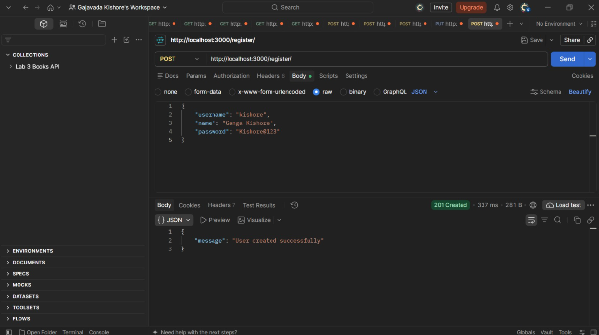
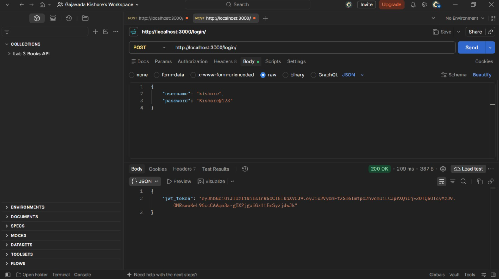
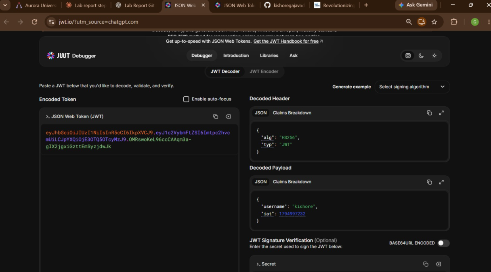
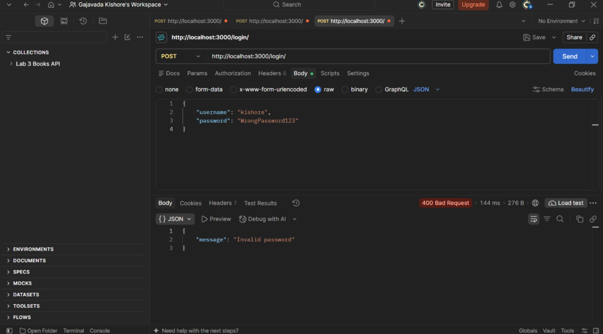
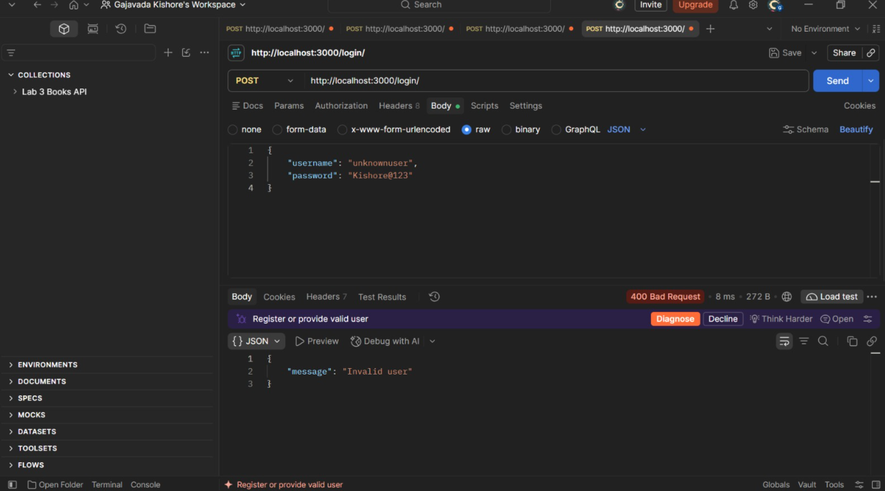
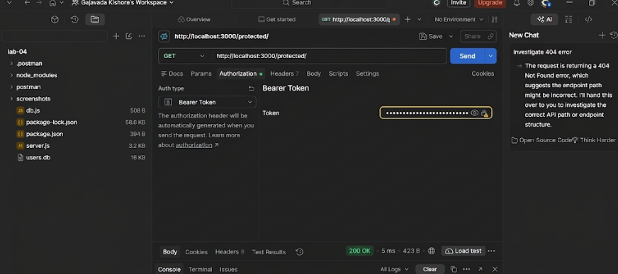

# Lab 4 – User Registration, Login and JWT Authentication

## Student Details
- Name: Gajawada Ganga Kishore
- Registration Number: 252U1R6068
- Section: AI&ML-2B-207

## Project Description
This project implements user registration and login using Node.js, Express, SQLite, bcrypt and JSON Web Tokens (JWT).

Passwords are hashed using bcrypt before being stored in the database. After successful login, the application generates a JWT token.

## Technologies Used
- Node.js
- Express.js
- SQLite
- bcrypt
- JSON Web Token (JWT)
- Postman

## Installation
```bash
npm install
```

## Run the Application
```bash
npm start
```

Server URL: `http://localhost:3000/`

## API Endpoints

| Method | Endpoint | Description |
|---|---|---|
| POST | /register/ | Register a new user |
| POST | /login/ | Login and generate JWT |

## Screenshots

### Registration




### Login






### JWT Decoding


## Security
- Passwords are stored as bcrypt hashes.
- SQL queries use parameterized inputs.
- JWT payload contains the username only.
- Secret keys should not be shared publicly.
